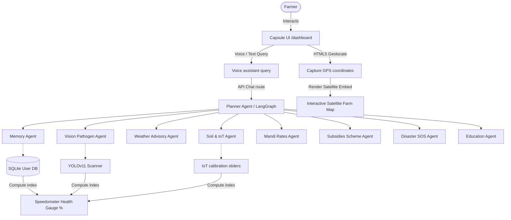

# Agriva 🌾

> **"खेती होगी स्मार्ट, भविष्य होगा मजबूत।"**

Agriva is an advanced, premium-design **Multi-Agent Farm OS** that integrates computer vision, IoT telemetry, Mandi pricing forecasts, emergency crisis support, and agricultural education into a unified, single-screen dashboard.

Instead of relying on a single chatbot, Agriva brings together specialized AI agents for agriculture, crop health, weather, market insights, healthcare, disaster preparedness, and education — working together to give farmers personalized, actionable recommendations.

Built using a stateful LangGraph Multi-Agent network on the backend and Next.js + TailwindCSS on the frontend, Agriva converts messy farm inputs (NPK metrics, leaf spots, regional queries) into actionable agriculture planning guides in under 60 seconds.

---

## 🚀 Key System Features

| # | Feature | Description |
|---|---------|--------------|
| 1 | **Top Floating Capsule Navbar (GDG Style)** | Designed after premium capsule layouts, centered and floating on starfield canvases. Features code-brackets branding, seamless tab transitions, localized language toggles, and dynamic notification indicator bells. |
| 2 | **GPS Geolocation & Farmland Satellite Geomap** | Prompts browser location permission on mount. Uses clean Google Satellite embed vectors (`maps.google.com/maps?t=k`) to display real-time farmland layouts inside the dashboard viewport without redirects. Overlays geofenced fields, pulsing IoT sensors, and YOLOv11 pathogen alert beacons dynamically. |
| 3 | **11 Regional Languages Support** | Complete localization dictionary binding across **English, Hindi, Punjabi, Marathi, Telugu, Tamil, Kannada, Gujarati, Bengali, Malayalam, and Odia**. Toggling the globe selector instantly updates voice assistants, leaf diagnostics, Mandi pricing graphs, emergency SOS guidelines, and academic quizzes. |
| 4 | **YOLOv11 Bounding Pathogen Scanner** | Computer vision engine segments crop leaves, alerts on diseases (e.g. Early Blight) with confidence scores, and plots diagnostic bounding boxes. |
| 5 | **Mandi Prices & MSP Tracker** | Scrapes live market Mandi rates, tracks government Minimum Support Prices (MSP), and graphs 6-month historical pricing trends. |
| 6 | **Interactive Krishi Academy** | Audio-guided lessons and gamified quizzes with reward badge trackers. |
| 7 | **Vibration-Feedback Emergency SOS** | Flash flood loss calculators, anti-snake venom locator maps, and pesticide poisoning first-aid guides. |

---

## 🛠️ Technology Stack

- **Frontend**: Next.js 16 (App Router), Webpack Compiler, TailwindCSS, Lucide Icons, HTML5 Geolocation API, Web Speech API.
- **Backend**: FastAPI, LangGraph (Stateful Agent Workflows), SQLAlchemy (Persistent user memory profiles), SQLite (Local fallback storage), Redis (Telemetry caching fallback), Qdrant Vector Database (Cosine similarity semantic RAG searching).
- **LLM**: Groq-hosted `openai/gpt-oss-120b` (about 1s per answer), falling back to `qwen/qwen3.8-27b` and then `openai/gpt-oss-20b` on Groq. Configurable with `CHAT_MODELS`.
- **Retrieval (RAG)**: NVIDIA NIM multilingual embeddings (`EMBED_MODEL`, default `nvidia/nemotron-3-embed-1b`) fused with local BM25 via Reciprocal Rank Fusion. Qdrant is the vector store when reachable, with an in-memory numpy index as fallback; document vectors are cached on disk so restarts cost no API quota. See [RAG pipeline](#-rag-pipeline).
- **Infrastructure**: Docker & Docker Compose (Redis + Qdrant services for local development).

---

## 🔎 RAG Pipeline

Retrieval grounds the advisory text farmers actually read, rather than sitting
beside it. The corpus is built on startup from every seed source — agronomy
advisories, government schemes, first-aid protocols, disaster guides, tutorials
and quiz explanations — plus any markdown under `backend/data/corpus/`.

**Hybrid search.** Dense embeddings handle paraphrase and cross-language
matching, which an 11-language app needs: a Hindi query matches an English ICAR
document directly, with no translation step. BM25 handles the exact terms dense
retrieval is weakest at — `PM-KISAN`, `Mancozeb`, `Alternaria solani`. Results
are fused by rank, so the two score scales never need to be comparable.

The vector dimension is probed from the first live embedding response rather
than hardcoded, so `EMBED_MODEL` can be swapped without a code change. If the
new model's dimension differs, the Qdrant collection is detected as mismatched
and rebuilt automatically on the next startup.

**Where retrieval is applied.**

| Surface | Use |
|---|---|
| Knowledge agent | Retrieves grounding documents for the query |
| Explanation agent | Injects them into the generation prompt with `[n]` citations |
| Vision advice | Grounds treatment guidance for detected YOLO labels |
| Healthcare / Disaster / Education | Selects the applicable guide semantically |
| Planner | Routes intent by embedding similarity, keywords as fallback |

**Graceful degradation.** Losing Qdrant falls back to an in-memory index;
losing the embedding API falls back to BM25-only retrieval. `retrieval_mode` in
`/api/rag/status` reports which path is active, so a degraded backend is
visible instead of looking like a quality regression.

Adding real reference material is a matter of dropping markdown into
`backend/data/corpus/<category>/` and restarting — see the
[corpus README](./backend/data/corpus/README.md).

```bash
curl "http://localhost:8000/api/rag/status"
curl "http://localhost:8000/api/rag/search?q=yellow+spots+on+tomato+leaves"
```

---

## 📊 System Architecture



---

## 🏃 Getting Started & Run Instructions

Ensure **Python 3.10+**, **Node.js 18+**, and **Docker** (with Docker Compose) are installed.

### 1. Clone the repository

```bash
git clone https://github.com/im-shlok/Vyntrix.git
cd Vyntrix
```

### 2. Start supporting services (Redis & Qdrant)

The backend depends on Redis (telemetry caching) and Qdrant (vector search). Start both with Docker Compose before running the backend:

```bash
docker compose up -d
```

This brings up Redis and Qdrant locally, matching the connection settings expected by the backend.

### 3. Configure environment variables

Create a `.env` file inside `backend/` (copy from `.env.example` if present) with values such as:

```env
# Groq key - powers the advisory LLM (chat, weather advisory, vision advice).
GROQ_API_KEY=your_groq_key_here

# NVIDIA NIM key - powers the RAG embedding model. Without it the system still
# runs, but retrieval degrades to BM25-only.
NVIDIA_API_KEY=your_nvidia_key_here

# Optional: chat models tried in order until one answers, as provider:model.
# A rate-limited or failing model hands over to the next one immediately.
# Append nim:google/gemma-4-31b-it to use NIM as a last resort; it is off by
# default because it measured 44-119s per answer.
# CHAT_MODELS=groq:openai/gpt-oss-120b,groq:qwen/qwen3.8-27b,groq:openai/gpt-oss-20b

# Optional: override the embedding model. The vector dimension is detected
# automatically, so changing this needs no code change.
EMBED_MODEL=nvidia/nemotron-3-embed-1b

# Optional retrieval tuning (calibrated for the default model; re-measure if you change it)
RAG_MIN_DENSE_SCORE=0.35     # cosine floor for dense hits
RAG_INTENT_THRESHOLD=0.35    # confidence below which the planner uses keywords

# Redis
REDIS_URL=redis://localhost:6379

# Qdrant
QDRANT_URL=http://localhost:6333

# Database
DATABASE_URL=sqlite:///./agriva.db
```

> ⚠️ Update these values/keys to match your actual `backend/app/core` configuration if the variable names differ.

### 4. Setup Backend

```bash
cd backend
pip install -r requirements.txt
uvicorn app.main:app --reload --port 8000
```

*Note: SQLite tables and Qdrant collections will self-seed on startup.*

### 5. Setup Frontend

```bash
cd frontend
npm install
npm run dev
```

Open [http://localhost:3000](http://localhost:3000) to launch Agriva.

---

## ☁️ Deploy as Vercel Services

The repository contains a root `vercel.json` that deploys two services under
one Vercel project:

| Service | Runtime | Public paths |
|---|---|---|
| `frontend` | Next.js | `/`, `/api/news`, `/api/mandi` |
| `backend` | Container using `backend/Dockerfile` | `/api/*`, `/static/*` |

The frontend service has a private `BACKEND_URL` binding to the backend service.
It is used only by the server-side `/api/mandi` route. Browser requests use the
same-domain `/api` rewrites and do not expose the private binding.

### Vercel setup

1. Import this repository as one Vercel project.
2. Keep the project root at the repository root; do not create separate Vercel
   projects for `frontend` and `backend`.
3. Add the backend secrets in Vercel Environment Variables. Use the names from
   `backend/.env.example` and never commit their values.
4. Use managed production services for `DATABASE_URL`, `REDIS_URL`, and
   `QDRANT_URL`. The local SQLite, Redis, and Qdrant defaults are for local
   development only.
5. Set `CORS_ORIGINS` to the deployed frontend origin if a separate browser
   origin will call the backend. Same-domain Vercel routes normally do not need
   an additional CORS origin.
6. Deploy with Vercel. For local multi-service testing, use `vercel dev -L` so
   Vercel injects the service binding locally.

### Persistence and runtime note

The backend writes temporary audio and vision files under `/static` and uses a
YOLO/Torch model plus FFmpeg. Vercel service instances have ephemeral local
storage, so those files should be treated as short-lived response artifacts,
not durable user storage. Durable uploads require object storage, and durable
application data requires managed PostgreSQL/Redis/Qdrant services.

The backend is configured as a container service because its Dockerfile installs
FFmpeg and the native packages needed by the vision/audio stack. The Dockerfile
installs the CPU-only PyTorch wheels in a separate image layer and uses
`opencv-python-headless` to avoid oversized Vercel Container Registry layers.
VCR currently allows up to 2 GB per compressed layer, so the original single
CUDA-heavy dependency layer could fail with HTTP 413 during upload. The backend
also reads Vercel's injected `PORT` value and falls back to port `8000` for local
Docker development.

---

## 📂 Project Directory Structure

```
├── backend/
│   ├── app/
│   │   ├── main.py             # FastAPI entrypoint, seeds database
│   │   ├── core/                # Redis, Qdrant, SQLAlchemy engines
│   │   └── agents/              # LangGraph Multi-agent workflow scripts
│   └── requirements.txt
├── frontend/
│   ├── src/
│   │   ├── app/                 # Next.js pages (/auth, /dashboard)
│   │   └── components/
│   │       ├── ui/              # Interactive 3D constellation shell
│   │       └── dashboard/       # Voice, Vision, Mandi, SOS, & FarmMap components
│   └── package.json
├── docker-compose.yml           # Redis + Qdrant local services
└── .gitignore
```

---

## 🤝 Contributing

Contributions are welcome! Please open an issue to discuss what you'd like to change before submitting a pull request.

1. Fork the repository
2. Create a feature branch (`git checkout -b feature/your-feature`)
3. Commit your changes
4. Open a pull request

---

## 📄 License

This project is licensed under the [MIT License](./LICENSE).

---


